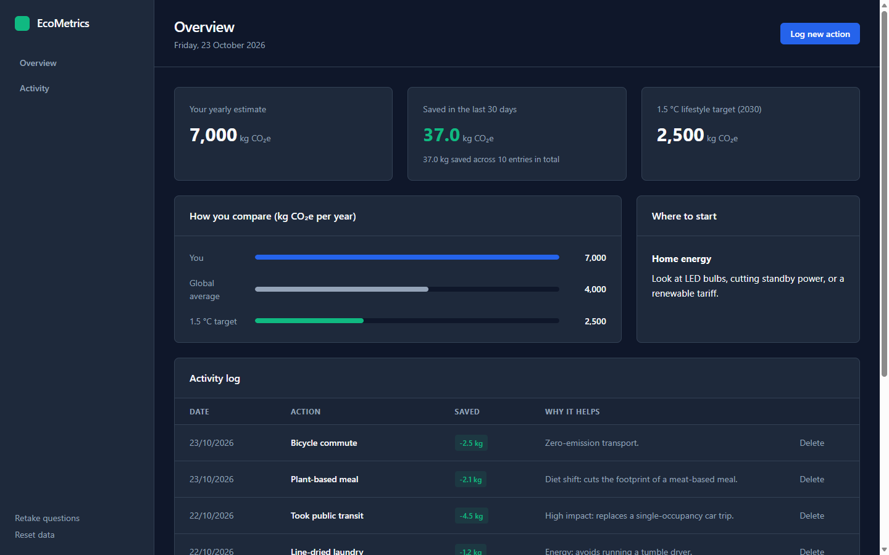

# EcoMetrics

A small carbon footprint tracker: answer five lifestyle questions, get a rough yearly estimate, then log eco-friendly actions and watch the savings add up.

[](https://github.com/vishnuatgit/carbon-footprint-tracker/actions/workflows/ci.yml)
[](LICENSE)
[](https://vishnuatgit.github.io/carbon-footprint-tracker/)



**Live demo:** https://vishnuatgit.github.io/carbon-footprint-tracker/

## What and why

I built this to learn more about web development and sustainability. It estimates your annual carbon emissions from your lifestyle and lets you log everyday eco-friendly actions to see how much you're saving over time. Everything runs in your browser; nothing is sent anywhere.

## Features

- **Five-question onboarding**: commute, diet, home energy, flights and shopping.
- **Yearly estimate** in kg CO₂e, compared with the global average and a 1.5 °C lifestyle target.
- **Where to start**: a tip for whichever category is largest in your answers.
- **Action log**: log things like taking the bus, a plant-based meal or a second-hand purchase. You get the CO₂ saved in the last 30 days and in total, and you can delete entries.
- **Saved in your browser** with localStorage, so your data is still there after a reload. Older saved data from the first version is migrated, and corrupt data can't crash the page.
- **Retake questions** or **reset data** at any time.

## How the estimate works

Each answer maps to a rough yearly figure in kg CO₂e for that part of your life. The estimate is the sum of the five:

```
yearly estimate = commute + diet + home energy + flights + shopping
```

For example, carpool or transit (1,200) + balanced omnivore (1,900) + standard grid mix (2,000) + 1–2 short-haul flights (1,000) + average consumer (900) = **7,000 kg CO₂e per year**.

Each logged action adds a fixed saving, for example 4.5 kg for a transit trip or 2.1 kg for a plant-based meal. Totals are summed in tenths of a kilogram so they don't drift (0.1 + 0.2 is exactly 0.3).

All factors live in one file, [`src/constants.js`](src/constants.js), with comments.

| Benchmark | Value | Source |
| --- | --- | --- |
| Global average footprint | ~4,000 kg CO₂e/year | The Nature Conservancy: "Globally, the average carbon footprint is closer to 4 tons." ([carbon footprint calculator page](https://www.nature.org/en-us/get-involved/how-to-help/carbon-footprint-calculator/)) |
| 1.5 °C lifestyle target | 2,500 kg CO₂e/year by 2030 | Hot or Cool Institute, [1.5-Degree Lifestyles](https://hotorcool.org/1-5-degree-lifestyles/) |

**Caveats.** The per-answer and per-action numbers are rough estimates I picked for learning, not scientifically precise. Real footprints depend on where you live, your grid's energy mix, distances and much more. Treat the result as a conversation starter, not a measurement.

## Tech stack

Kept it simple on purpose: no frameworks, no build step, no npm dependencies.

- HTML, CSS and JavaScript (ES modules)
- localStorage for persistence
- Node's built-in test runner (`node --test`) for unit tests
- GitHub Actions for CI and GitHub Pages for hosting

## Run locally

The app uses ES modules, which browsers won't load from a `file://` URL, so serve the folder with any static server:

```bash
git clone https://github.com/vishnuatgit/carbon-footprint-tracker.git
cd carbon-footprint-tracker
python -m http.server 8105
```

Then open http://localhost:8105. (The VS Code Live Server extension works too.)

## Running tests

Needs Node 20 or newer. There is nothing to install.

```bash
node --test
```

The tests cover the footprint calculation, answer validation, per-action savings, totals and the 30-day window, benchmark bar scaling, storage round-trips, migration of old saved data, corrupt or blocked storage, and a static check that every element id the script uses exists in the page and that all asset paths are relative. CI runs them on Node 20 and 22 for every push and pull request.

## Project structure

```
index.html            page markup
style.css             styles (dark theme, responsive, reduced motion)
src/
  app.js              DOM wiring: onboarding, dashboard, dialog, log table
  calculator.js       pure maths: footprint, savings, totals, date window, bar scale
  storage.js          load/save, validation and migration of saved data
  constants.js        questions, actions, emission factors and benchmarks
tests/                node --test unit tests
.github/workflows/    CI
docs/screenshot.png   README screenshot
```

## Accessibility notes

- Everything works with a keyboard. Buttons are real `<button>` elements, and there is a visible focus outline.
- The log dialog has `role="dialog"`, a labelled heading, moves focus inside when it opens, closes with Escape, and returns focus to the button that opened it.
- Onboarding announces "Question X of 5", has a labelled progress bar, and moves focus to each new question.
- Logging or deleting an action is announced through a polite live region.
- The primary button colour passes WCAG AA contrast with white text.
- Animations are switched off for people who set `prefers-reduced-motion`.
- The layout works down to a 360 px wide phone screen.

## Limitations and roadmap

- The model is deliberately coarse: five multiple-choice answers, fixed savings per action.
- Data lives in one browser. Clearing site data removes it, and it doesn't sync between devices.
- Ideas for later: export and import as JSON, a quantity and date when logging, a light theme, and region-specific factors.

## License

[MIT](LICENSE) © 2026 Chandana Vishnu Jayanth
